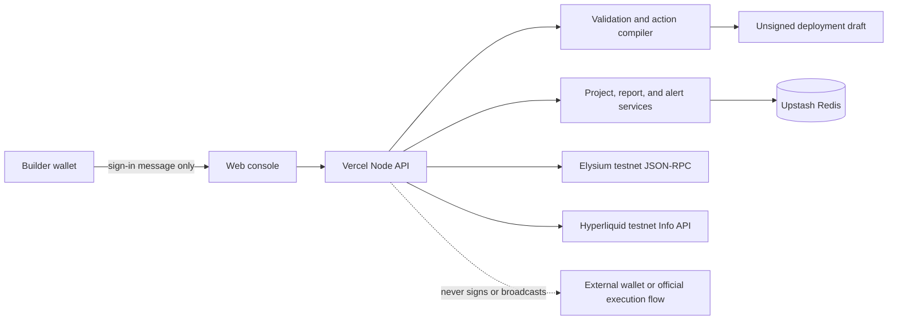

# PathForge architecture

PathForge is a non-custodial lifecycle console for teams preparing an Elysium token for HyperCore graduation. It separates public-chain evidence, deterministic planning, authenticated project data, and transaction execution. The current release intentionally stops before signing or broadcasting.

## Components

| Layer | Responsibility |
|---|---|
| Browser console | Project navigation, wallet authentication, planning, reports, monitoring, and alert-rule management |
| API router | Input limits, ownership checks, rate limits, security headers, and stable JSON endpoints |
| Token inspector | Reads ERC-20 metadata and bytecode from Elysium testnet RPC |
| HyperCore adapter | Reads ticker, market, and deployer evidence from the Hyperliquid testnet Info API |
| Validation engine | Enforces ticker, decimal, supply, recipient, allocation, and ceremony invariants deterministically |
| Action compiler | Produces inspectable unsigned payloads only after preflight passes |
| Persistence | Upstash Redis in production; atomic JSON storage during local development |
| Authentication | Nonce-bound EVM message signature; signed HTTP-only, Secure, SameSite=Strict session cookie |

## Trust and evidence model

PathForge labels data by source and does not convert unknown private criteria into a green status. Token evidence comes from Elysium RPC. Ticker, market, and deployer evidence comes from the public Hyperliquid testnet API. Bridge synchronization and permanent-link state remain `unavailable` until an authoritative public interface exists.

Project writes require the owning wallet session. Public demo projects are readable but immutable. Private keys are never requested, wallet transactions are never submitted, and generated actions are explicitly unsigned.

## Request flow

1. A builder connects a wallet and signs a short-lived human-readable challenge.
2. The server verifies the signature and issues a scoped session cookie.
3. The builder creates a project around an Elysium token address.
4. Live adapters collect token and HyperCore evidence.
5. The deterministic engine validates the proposed ceremony plan.
6. PathForge stores validation history and produces a portable report or unsigned draft.
7. Monitoring refreshes public evidence and evaluates user-defined rules without claiming unverifiable states.

## Deployment

The static console and Node API deploy together on Vercel. Upstash Redis provides shared persistence and rate-limit counters across serverless instances. GitHub Actions runs syntax checks, tests, and a high-severity dependency audit on every push and pull request.
